# 课程入口 · AI 课程入口导航器（Android 原型）

把散落在 QQ 群、微信群、钉钉群、公众号和各个学习平台里的课程通知与课表，整理成可一键跳转的**课程入口卡片**、**待办**，并在**作业截止前**和**上课前**发本地系统通知。不登录第三方平台、不爬取平台数据，只做用户主动导入后的本地整理与入口分发。

- 赛题：赛题一「AI 辅助开发 · 创意产品原型」
- 形态：Android 原生 APK（WebView 壳 + 本地规则引擎），支持 Android 7.0+
- 性质：非营利校园公益原型，不收费、不广告、不转售数据
- 包名：`com.coursenav`　版本：1.8.0

先看这两份：

- [功能总览](FEATURES.md)：所有功能、默认规则、边界
- [新手指引](GUIDE.md)：从安装到导入第一条通知

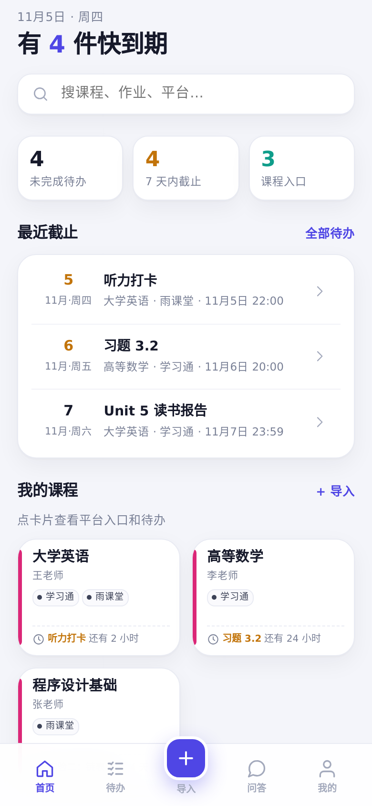

首页三个数字都能点：**未完成待办**和 **7 天内截止**会进入待办页并切好筛选，**课程入口**会直接滚到下面的课程列表。

顶部搜索框只筛选本地课程和待办，不会跳去问答；想提问请用底部「问答」。

## 安装

1. 把 `CourseNav.apk` 传到手机（本交付已放在 `Download/DSH-Go/`）。
2. 用文件管理器点开 APK；系统提示「未知来源」时，允许当前文件管理器安装。
3. 首次进入建议点首页「载入示例」，先看完整效果；再回导入页粘贴自己的通知。
4. Android 13+ 首次设置提醒时会申请通知权限。没有通知权限时，待办仍会保存，但不会弹系统提醒。

> 这是 debug 签名的原型包，用于比赛演示和同学试用，不上架应用商店。

## 核心闭环


**导入通知 / 截图 / 课表图片 / PDF 课表 → 本地识别课程、平台、任务、截止、上课时间、周次和来源 App → 自动保存为入口卡片、待办和上课提醒 → 到点通知 → 问答或点入口 → 跳转/复制降级 → 标记完成**

### 1. 导入（两个入口）

- **通知**：粘贴群消息，或点「选择截图」选一张群通知截图；两者共用下面的文字框，识别后直接保存。
- **课表**：粘贴一行一节课的文本（如 `周一 1-2节 高等数学 李明 教二305`），或选课表截图（JPG / PNG）/课表 PDF。表格截图按列头周几、左侧时间轴和彩色块还原；PDF 在本地读取文字与坐标，保留 `(1-3节)2-17周`、`7-9周(单)`、`2-16周(双)` 这类周次。
- 每条导入记录来源和导入时间；不读取任何第三方平台页面。

### 2. 识别与自动保存

识别在本地完成，输出固定字段：课程名、教师、平台（含用途）、任务、截止时间、群/公众号、上课时间、周次、各字段置信度、来源、来源 App、原文。

- **导入后直接保存**，不再要求逐字段确认；保存后可在课程详情里编辑、合并或删除。
- 群聊截图第一次会让你选一次来源（钉钉群 / QQ群 / 微信群 / 学习通 / 雨课堂 / 其他），选完记住到这门课；以后同一门课的同类截图自动套用，不再重复问。群名当课程、成员区姓名当教师、置顶消息当作业。
- 来源选错可在课程详情点「修改来源」；记忆按课程保存，不会影响其他课。
- 同名课程再次导入会**增量合并**平台、待办和上课时间，不重复建卡。
- 保存失败或课程名没识别出来时，会打开编辑页把其余字段填好，只让你补课程名；这不是逐字段确认。

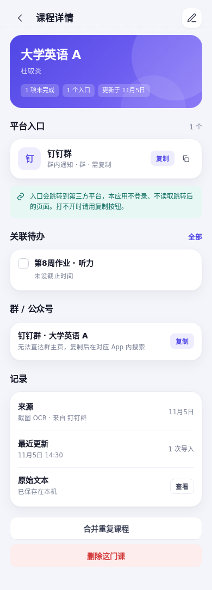

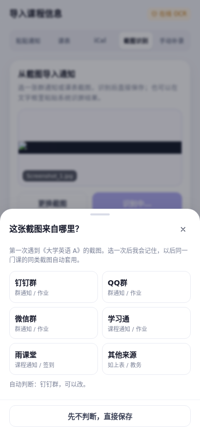

### 3. 课程卡片与入口

每门课一张卡片：教师、各平台入口及用途、关联待办、上课时间、最近更新时间、入口状态（可用 / 需复制 / 待补链接）。

课程详情「关联待办」右上角可 **+ 添加任务**：粘贴群通知或选截图识别，识别出的任务只加到这门课并自动排提醒；同名同日的任务不会重复添加。

- 网页用系统浏览器/自定义标签页打开；App 尝试 URL Scheme / Intent。
- **钉钉群可直接打开**：在课程的「群 / 公众号」里粘贴群邀请链接后，点「打开群聊」会直接唤起钉钉；没有链接时打开钉钉「我的群组」列表，再点对应群。QQ/微信群仍以复制群号/群名为主；公众号只能打开单篇文章。
- 每个入口都有「复制」降级；打不开不会白屏，会提示换复制。
- 界面明确提示：跳转至第三方平台，本应用不读取跳转后的页面。

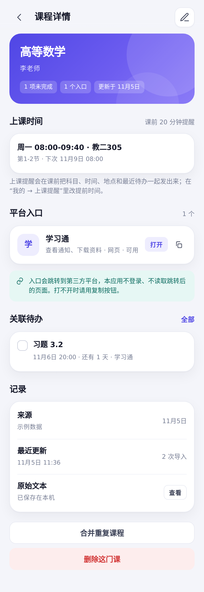


### 作业平台跳转

群通知里的 `(1)(2)(3)` 编号任务会逐条拆分，每条单独识别截止时间和平台；例如 PTA 习题和雨课堂作业不会串到同一个平台。


内置以下平台入口；任务卡片点一下先弹确认，不会直接跳走：

- 学习通（超星）、泛雅、雨课堂、PTA（拼题A）、智慧树 / 知到、课堂派、蓝墨云班课、优学院、TronClass（畅课）、微助教、U校园（外研社）、凌极
- 数你最灵、腾讯作业君没有统一网页入口：确认页会说明，并提供复制平台名，去对应 App / 小程序搜索
- 其他平台（中国大学MOOC、学堂在线、批改网、We Learn、问卷星等）也可识别

确认页会显示课程、任务、截止时间和平台名；点“打开”才离开应用，点“取消”留在本页。平台只在系统浏览器或对应 App 打开，应用不登录、不读取页面。

### 钉钉群直达

在课程详情点右上角编辑，找到「群 / 公众号」：

1. 类型选「钉钉群」；
2. 在钉钉里打开群设置 → 群二维码 / 邀请链接，复制链接；
3. 粘贴到「群邀请链接（可选）」并保存。

之后课程详情和平台入口里的「打开群聊 / 打开」会直接唤起钉钉。没有链接时按钮显示「去钉钉」，会打开钉钉「我的群组」列表，请点对应群；不会编造 chatId。


### 4. 待办、作业提醒与上课提醒

**作业截止提醒**

- 任务自动聚合，按截止时间分组：已逾期 / 今天 / 明天 / 本周内 / 更晚。
- 同一通知多次粘贴，按「任务名 + 日期」去重。
- 默认截止前 1 小时发本地系统通知，可在「我的 → 作业截止提醒」改。
- 识别到没有写截止时间的任务时，默认取该课程**下一次上课前 10 小时**；如果这个时间落在 22:00–06:00，则改为**前一天 21:00**。任务行会显示具体日期时间并标注“默认课前10小时 / 默认前晚21:00”，可在课程编辑里修改或清空。

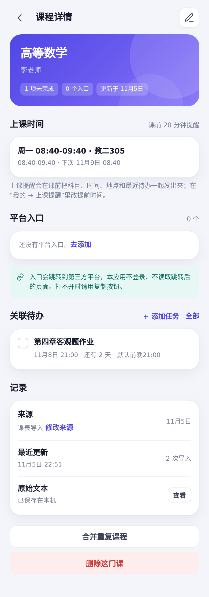
- 点任务左侧圆圈标记完成，同时取消该任务提醒。

**上课提醒**

- 导入课表后，每门课保存为若干「上课时间」：周几、起止时间、地点、节次。
- 默认课前 **20 分钟**发系统通知，可在「我的 → 上课提醒」改成 5–60 分钟。
- 通知内容示例：`还有 20 分钟上课 · 高等数学` / `08:00-09:40 上课 · 教二305 · 李明 · 待办：习题3.2（11月6日 20:00）`。
- 只带**这节课之后到期**的最近一条未完成待办，避免把已经过期或无关的作业塞进通知。
- 每节课预排未来约 10 周；打开 App 会自动续排。关闭开关或删除课程会取消对应提醒。
- 节次时间按课表作息换算（PDF 课表 1 节 08:40；文本课表 1–2 节 08:00–09:40）；课表里写了具体时间就以课表为准。
- 支持单双周：第 9 周单周课只会在第 9/11/13…周提醒；学期第 1 周周一可在「我的 → 上课提醒」里改。

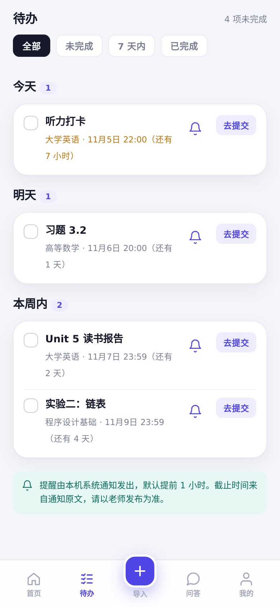
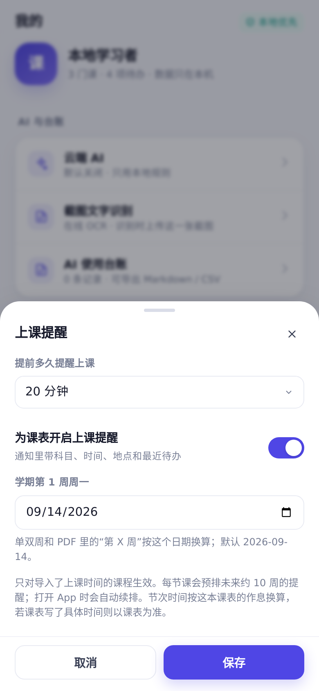

### 夜间模式

「我的 → 外观 → 夜间模式」可切换深色界面；状态栏和导航栏图标会同步，设置保存在本机。

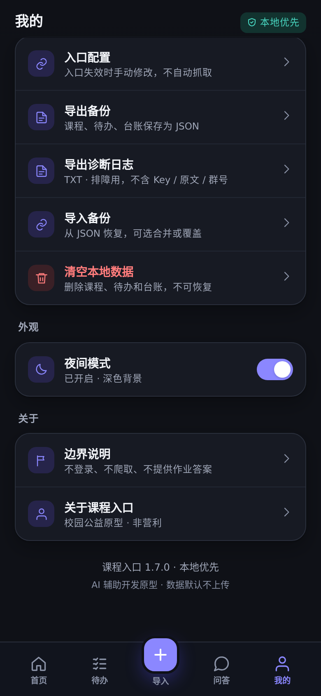

### 5. 通知截图与表格课表

课表页也提供「选择课表截图（JPG / PNG）」入口，适合只有班级群课表图片、没有文字版的情况。

**表格课表（1.2 新增，1.4 改为自动保存）**

常见教务课表是「顶部周几、左侧节次/时间、彩色块代表一门课」的表格，截图 OCR 出来的文字里没有“周一 1-2 节”这样的行。现在会这样做：

- OCR 时同时请求每个文字块的位置坐标；
- 在本地用坐标找列头（周一…周五）、左侧时间轴和节次；
- 用 Canvas 检测彩色课块的上下边界，按颜色突变切开相邻课程；
- 把每个块里的课程名、教师、地点和起止时间还原成 `sessions`，**直接保存**并生成上课提醒。

例：第 8 周课表截图可还原出 7 门课，包括 C语言程序设计（周一 08:40-11:10 正心楼521）、高等数学A1（周二/周五两段）、大学英语A（周二/周四两段）等，保存后直接生成课前提醒。

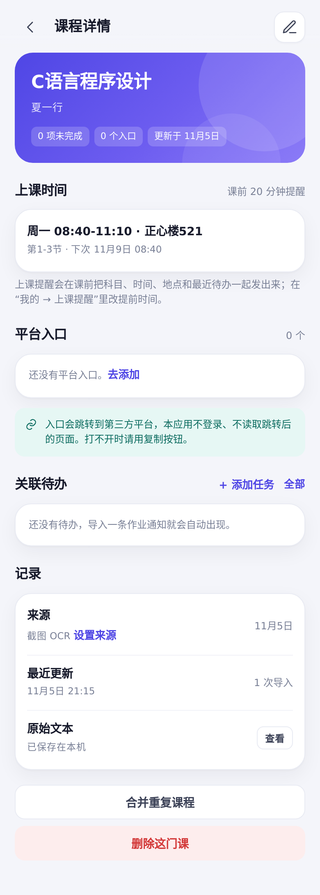

**课表 PDF（1.3 新增）**

教务系统导出的 PDF 常常是「星期几列 + 左侧节次 + 课程块」的表格，并且带单双周。App 直接读取 PDF 的文字层和坐标：

- 本地用 pdf.js 提取每段文字的位置，不上传 PDF；
- 按「星期一…星期日」列头分列，按 `(1-3节)2-17周` 这类行定位课程块；
- 保留 `第2-17周`、`第3周,7-9周(单),13-17周(单)`、`第2-16周(双)` 等周次；
- 保存后按学期周过滤上课提醒，单周课不会在双周弹通知；
- 页脚的「其他课程」暂不生成卡片。

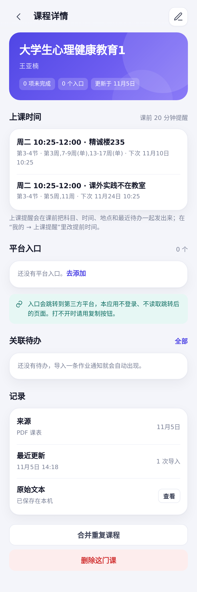

适用与限制：

- 需要有**彩色课块**和可见的周几/时间轴；纯黑白或没有颜色块的表格，请改用「课表文本」。
- 当前按周一至周五 5 列还原；含周末列的课表可能识别不全。
- 在线 OCR 只返回文字和坐标，版式重建在手机本地完成；识别完直接保存，可在课程详情修改。
- 图片会被压缩到最长边 2200 像素再上传，长截图能保留足够文字；原图不写入课程数据。

**群通知截图**

- 在「导入 → 通知」点「选择截图」；首次会请你确认是否上传这一张图，之后选图即自动识别、自动保存。
- 如果是 QQ/微信/钉钉群作业截图，会还原群名课程、教师、置顶作业，并记下来源 App（如“来自 QQ群”）。
- 如果截图是整张课表（表格或多行「周几 + 节次/时间」），会自动生成多门课和上课提醒，不再逐门勾选。
- 识别只负责图转字；课程、平台、截止时间仍由本地规则抽取，保存后可直接编辑。
- 默认使用 OCR.space 公共演示 Key（**helloworld**），额度极易被占满，可能随时返回 HTTP 429；请在「我的 → 截图文字识别」换成自己的免费 Key 或其他兼容接口。
- 如果提示 **HTTP 429 / Rate limit exceeded**：不是截图坏了，是公共演示 Key 被所有用户共用后限流。请点「我的 → 截图文字识别 → 获取免费 Key（浏览器）」，注册后填自己的 Key；或改用系统识屏、把文字粘贴到通知框。
- 免费 Key 填一次后只存本机；换 Key 不需要重装应用。
- **截图可能含姓名、学号、群号**：只有你选图并首次同意后，当前这一张图才会发给 OCR 服务；原图不写入课程数据，也不进入导出备份。介意隐私时请用系统识屏/相册文字提取后粘贴，完全本地。
- 无网络或识别失败时，可直接在文字框粘贴系统识屏结果，或直接在「通知」的文字框里粘贴。

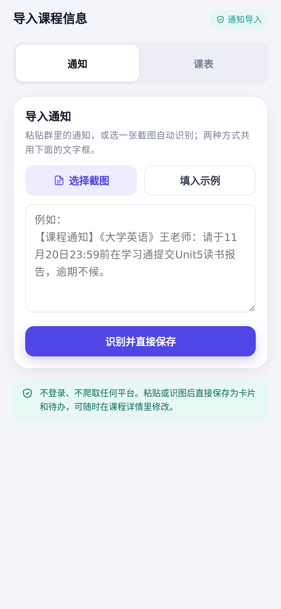
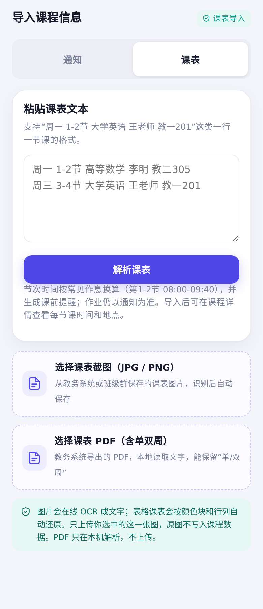

### 6. 问答

优先走**在线 AI**（配置 Key 后），把问题连同课程名、待办、入口用途、上课时间发给接口；未配置或请求失败时自动用本地意图识别 + 检索兜底。在线 AI 只依据本地课程数据回答，不生成作业答案：

- 「大学英语作业在哪交？」→ 返回对应平台入口按钮
- 「这周还有什么没做？」→ 汇总未完成待办
- 「英语课在哪个平台签到？」→ 返回签到平台入口

找不到时提示换课程名、去导入或编辑课程。

在线问答在「我的 → 在线 AI」里填 **API Key** 后生效；没有 Key 或请求失败时会自动回退本地检索，不会卡住。

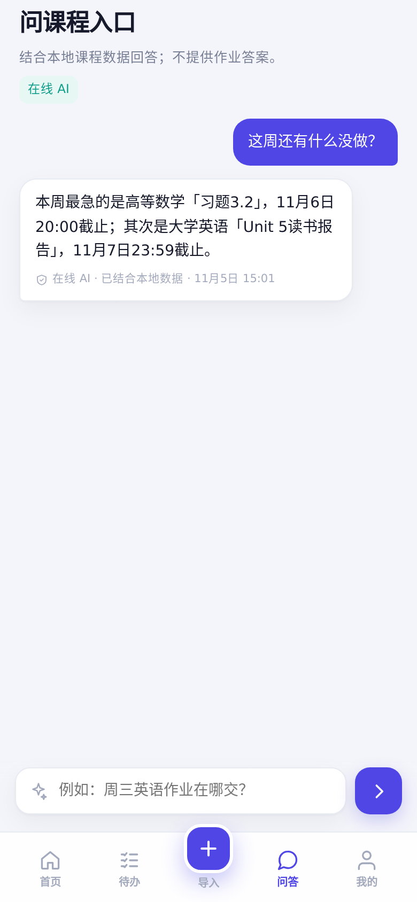
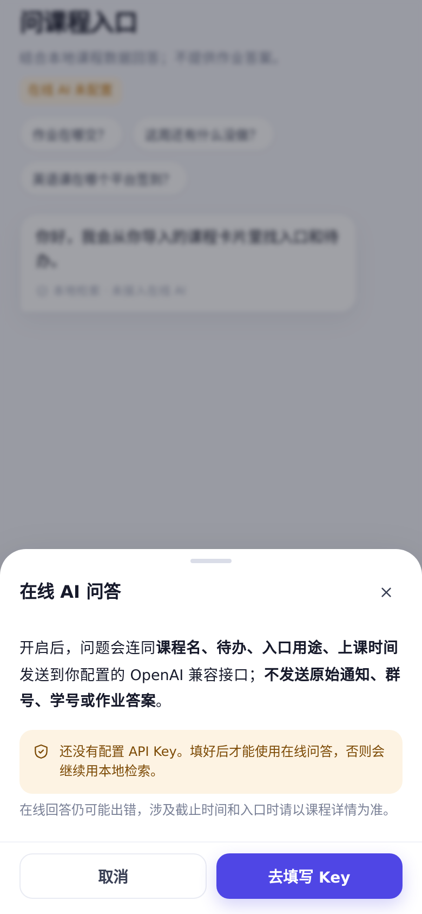

## 数据与隐私

- 课程、待办、原始文本、AI 台账默认**只存本机**（WebView localStorage + 原生提醒记录）。
- 不登录任何平台账号；不爬取、不注入、不自动读取平台页面。
- 可导出 JSON 备份（**不含 API Key**）和 Markdown / CSV 台账。
- 「清空本地数据」会删除课程、待办、群信息和台账，并取消全部提醒，不可恢复。

### 在线 AI（识别默认关闭，问答可选）

设置页可配置任意 OpenAI 兼容接口（示例：DeepSeek），识别和问答共用 Key。

- **识别**：默认关闭；开启后仍需在导入页手动点「云端增强识别」，确认脱敏预览后才发送该段文本。
- **问答**：开启后，问题会连同课程名、待办、入口用途和上课时间发给你填写的接口；不发送原始通知、群号、学号或作业答案，请求失败时自动回退本地检索。
- 没有 Key 时不会发请求，问答显示「在线 AI 未配置」，继续使用本地检索。所有云端结果仍会保存，可在课程详情编辑。

### 在线 OCR（默认开启，可关闭）

只在你选图并首次同意后，把当前选中的一张截图发到 OCR 接口。接口地址、Key、语言可在设置里改；Key 只存本机，导出备份时清空。默认测试 Key 仅用于演示，正式使用请换成自己的 Key。

## AI 使用台账

App 自动记录每次识别/编辑/问答/合并/通知截图识别的：工具、环节、关键 Prompt、输入、输出、人工修改、核查人、时间。可在「我的 → AI 使用台账」导出 Markdown 或 CSV，直接对应比赛要求的「AI 工具使用说明 + 人工核查」材料。

## 导出诊断日志（内测反馈）

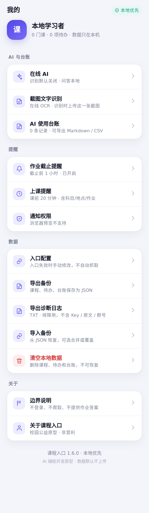

内测时遇到问题，进「我的 → 导出诊断日志」，会保存一个 TXT 到 `Download/DSH-Go/`，直接发给开发者即可。

日志包含：版本、设备/系统、通知权限、功能开关、数据量、课程摘要（名称/教师/平台数/时段数/待办数）、最近的错误堆栈和操作记录。

日志**不包含**：API Key、原始通知文本、群号/群名、入口链接、学生姓名学号。课程名会保留，方便判断是哪门课出的问题。

为了更快定位，反馈时最好再补三句话：

1. 你刚才点了什么（从哪个页面开始）；
2. 你以为会发生什么；
3. 实际发生了什么。能附截图更好。

## 边界与已知限制

- 不登录第三方平台，不爬取、不注入、不自动读取平台页面。
- 钉钉群只有在保存了群邀请链接时才能直接进群；没有链接时会打开钉钉群列表，不会伪造群 ID。QQ/微信群大多只能复制群号/群名后搜索；公众号无法直达主页。
- 不提供作业答案、解题思路或内容生成。
- 截止时间来自通知原文，可能识别有误，请以老师发布为准。
- 截图 OCR 是在线服务，不是离线模型；无网络时不可用。默认测试 Key 有频率限制。
- 自动保存依赖识别结果；如果课程名/任务名识别错了，不会弹确认页，请到课程详情编辑或删除。QQ/微信/钉钉群截图的作业若没有明确截止时间，待办会显示“未设截止时间”。
- 上课提醒预排约 10 周；支持单双周，但不识别临时调课、节假日和考试周。节次时间按课表作息换算，可能和本校不同，课表写了具体时间则以具体时间为准。
- 精确闹钟在部分系统上会被限制，App 会自动退化为 10 分钟窗口提醒；通知权限需用户手动授予。
- 课程平台入口默认指向平台首页，登录后需自己找到对应课程；可在编辑页改成具体链接或 App scheme。
- v1.4.x 未包含：离线 OCR、云同步、iOS 版。截图表格课表依赖彩色课块，纯黑白表格请改用 PDF 或课表文本。

## 开发与 AI 使用说明（比赛材料）

- 开发方式：在 Android/aarch64 proot 环境中，用 DeepSeek Harness 编码代理完成需求梳理、原型代码、构建脚本与自动化测试；人工负责需求边界、交互取舍、合规检查和最终验收。
- 运行时 AI：识别默认由**本地规则引擎**（正则 + 关键词 + 日期解析）完成；配置 Key 后，问答走在线 AI，失败自动回退本地；截图 OCR 仅在用户确认后联网。
- 测试：Chromium 390×844 移动视口跑通「钉钉群作业截图 → 大学英语 A/杜驭炎/第8周作业、表格课表截图 → 7 门课/54 条上课提醒、PDF 课表 → 9 门课/13 个时段/86 条上课提醒（含单双周过滤）、粘贴通知自动保存、课表文本、作业提醒、在线 AI 问答（模拟接口返回）、台账、钉钉群链接直达/无链接打开钉钉群列表、备份恢复」，无 JS 报错；APK 已用 v2/v3 签名并通过 zipalign。
- 在线 AI 问答需要可用的 OpenAI 兼容接口和 Key，可能产生调用费用；不上传原始通知/群号/学号。
- 说明：本环境无法直接调用手机 `pm install`，APK 未在真机上做安装回归，请首次安装后按上面流程走一遍。

## 项目结构

```
course-nav/
├─ AndroidManifest.xml
├─ build.sh                 # aapt2/javac/d8/zipalign/apksigner 一键构建
├─ java/com/coursenav/      # WebView 壳、通知、开机重排、截图选择、OCR 请求
├─ assets/www/              # index.html / style.css / parser.js / app.js
├─ assets/www/vendor/       # pdf.js、worker、中文 cmaps（本地解析 PDF）
├─ res/                     # 图标、主题、通知小图标
├─ docs/                    # 说明用截图
└─ CourseNav.apk            # 已签名安装包
```

重新构建（需要 JDK 17、Android build-tools 34、platform-34）：

```bash
cd course-nav
./build.sh
# 输出 CourseNav.apk
```

## 合规声明

本项目为非营利校园公益原型，不收集、不转售用户数据，不提供任何绕过平台登录或自动化操作的能力。所有第三方内容均来自用户主动粘贴/导入/截图，跳转行为由系统浏览器或 Intent 完成；截图 OCR 首次需用户同意，且可在设置中关闭。
